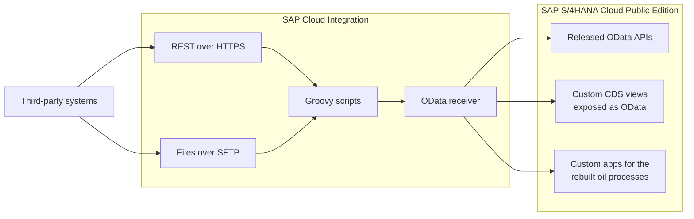

# SAP IS-Oil Integration

Integration of an oil and gas marketing company's third-party systems into SAP S/4HANA Cloud Public Edition, where the company's IS-Oil-style processes were rebuilt clean-core. Built on SAP Integration Suite (Cloud Integration, also known as CPI).

This repository documents how the integration works. It does not contain the iFlows, scripts or configuration themselves, because they belong to a client project. Client names, system URLs, credentials and business data are left out on purpose.

## Background

IS-Oil is SAP's industry solution for oil and gas; its downstream part covers marketing and distribution. The client, an oil marketing company, had legacy custom logic in the IS-Oil style for trucks, shipments, tank stock and pricing. SAP S/4HANA Cloud Public Edition does not include IS-Oil, so on this project those processes were rebuilt clean-core on standard S/4HANA Cloud, with custom apps for truck master data, shipment pricing, primary and secondary shortages, physical inventory counts, tank uploads and the customer ledger.

The client's third-party systems for these processes then had to send their data into S/4HANA Cloud. SAP Cloud Integration sits between them and S/4HANA Cloud and handles that traffic.

## What the integration covers

| Process | Data | Direction |
|---|---|---|
| Procure-to-pay | Purchase orders, goods receipts, supplier invoices | Third-party systems to S/4HANA Cloud |
| Trucks and shipments | Truck master data, shipments, shipment pricing | Third-party systems to S/4HANA Cloud |
| Tanks and stock | Tank levels, stock, shortages, physical inventory | Third-party systems to S/4HANA Cloud |
| Sales and billing | Sales orders, deliveries, customer invoices and ledger data | Third-party systems to S/4HANA Cloud |

## Architecture

Some data comes in through REST calls over HTTPS, and some comes as files on an SFTP server that Cloud Integration picks up on a schedule.

## How a message flows

1. **Receive.** The iFlow gets the data from the third-party system, either as a REST call over HTTPS or as a file picked up from the SFTP server.
2. **Check.** Groovy scripts check the incoming data, for example that required fields are filled and that numbers and dates are in the right format, so bad records are caught before they reach S/4HANA.
3. **Use S/4HANA data.** Where the standard APIs do not give the iFlow the data it needs, it reads it from custom CDS views that are exposed as OData services.
4. **Map.** Groovy scripts convert the third-party format into the structure the S/4HANA API expects.
5. **Post.** The OData receiver adapter calls the released S/4HANA Cloud API for standard objects such as purchase orders, goods movements, supplier invoices and sales orders, or the OData service behind the custom apps for the rebuilt oil processes.

## S/4HANA Cloud setup

- **Standard APIs.** Cloud Integration is registered in S/4HANA Cloud as a communication system with a communication user for inbound calls. For each communication scenario that contains the needed APIs, a communication arrangement links the scenario to that communication system.
- **Custom CDS views.** The custom CDS views were created with the External API scenario, so publishing them creates an OData service. These services were added to a custom communication scenario and activated with a communication arrangement, so Cloud Integration can call them.
- **Rebuilt oil processes.** The data that only existed in the old IS-Oil-style solution (for example truck master data and shortages) is handled by custom apps built clean-core in S/4HANA Cloud, and Cloud Integration reaches it through OData.

For reference, these are the standard released APIs for the objects above. Which API and version fits best depends on the S/4HANA Cloud release, so check the SAP Business Accelerator Hub:

| Object | Standard API |
|---|---|
| Purchase orders | Purchase Order (`API_PURCHASEORDER_PROCESS_SRV`, OData V2, deprecated since release 2308; successor `API_PURCHASEORDER_2`, OData V4) |
| Goods receipts and other goods movements | Material Document (`API_MATERIAL_DOCUMENT_SRV`) |
| Supplier invoices | Supplier Invoice (`API_SUPPLIERINVOICE_PROCESS_SRV`) |
| Physical inventory | Physical Inventory Document (`API_PHYSICAL_INVENTORY_DOC_SRV`) |
| Sales orders | Sales Order (`API_SALES_ORDER_SRV`) |
| Outbound deliveries | Outbound Delivery (`API_OUTBOUND_DELIVERY_SRV;v=0002`) |
| Customer invoices | Billing Document Request (`API_BILLINGDOCUMENTREQUEST`, OData V4) for billing data from an external system, and Billing Document (`API_BILLINGDOCUMENT`, OData V4) to create the invoice. The older `API_BILLING_DOCUMENT_SRV` (OData V2) can only read, cancel and print billing documents. |

## Error handling and monitoring

- The iFlows catch errors in an exception subprocess, so a failed call to S/4HANA is logged together with the S/4HANA error text.
- Runs are checked in the Cloud Integration message monitor, where each message can be followed from the incoming call or file to the S/4HANA response.

## Security

- No credentials are stored inside the iFlows. They are kept as security material in the Cloud Integration tenant.
- In S/4HANA Cloud, the communication user can only call the services of the communication arrangements it is assigned to, so it has no access beyond what the integrations need.

## Tools and technologies

- SAP Integration Suite, Cloud Integration (CPI)
- SAP S/4HANA Cloud Public Edition
- OData and REST over HTTPS
- SFTP for file-based data
- Groovy scripts
- Custom CDS views and custom communication scenarios

## My role

I built the Cloud Integration iFlows that bring data from the client's third-party systems into S/4HANA Cloud Public Edition, together with the Groovy scripts and custom CDS views they use.

## Author

Hamza Tahir, SAP Consultant (BTP, ABAP and Fiori)
[LinkedIn](https://www.linkedin.com/in/hamza-tahir-49618a1b2/) · [GitHub](https://github.com/Hamza-Tahirr)
